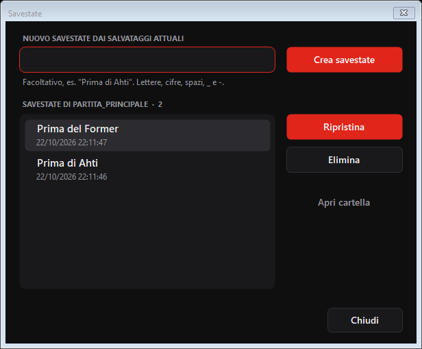
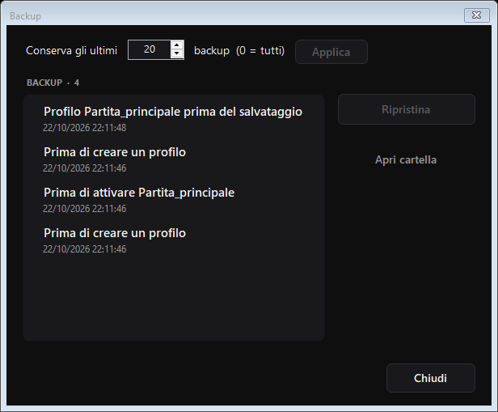
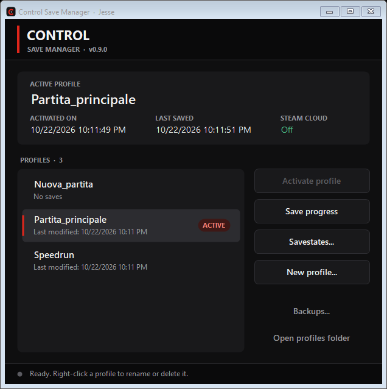

# Control Save Manager

Più partite di **Control** (Steam) sullo stesso account, e passare dall'una
all'altra in un clic. Con savestate da usare prima dei punti difficili e un
backup automatico prima di ogni operazione.

*[English below](#english)*

## Installazione

1. Scarica `ControlSaveManager-<versione>-win-x64.zip` dalla pagina dei
   rilasci ed estrai `ControlSaveManager.exe` dove vuoi.
2. Avvialo. Non serve installare nulla: il programma contiene già tutto quello
   che gli serve (per questo pesa circa 50 MB).

Requisiti: Windows 10 o 11 a 64 bit, Control su Steam avviato almeno una volta.

> **Windows potrebbe avvisarti o bloccarlo.** Il programma non è firmato
> digitalmente, quindi SmartScreen può mostrare "Windows ha protetto il PC"
> (scegli *Ulteriori informazioni → Esegui comunque*) e Smart App Control, se
> attivo, può impedirne l'avvio.

### Prima di cominciare: disattiva Steam Cloud per Control

Con Steam Cloud attivo, Steam può rimettere nella cartella del gioco i
salvataggi che ha nel cloud e mescolare le partite. Disattivalo per Control:
in Steam, **Libreria → tasto destro su Control → Proprietà → Generale** e
spegni *Mantieni i salvataggi su Steam Cloud*.

Il programma mostra lo stato del cloud nella finestra principale (*Steam
Cloud: Disattivato* in verde va bene).

## Come si usa

**Chiudi Control prima di usare il programma**: finché il gioco è aperto i
pulsanti restano disattivati.

### Profili

Un profilo è una partita. Il profilo con la barra rossa e la scritta
*ATTIVO* è quello i cui salvataggi sono ora nel gioco.

- **Nuovo profilo...**: crea un profilo con i salvataggi attuali del gioco
  oppure vuoto, per iniziare una nuova partita.

  

- **Attiva profilo** (o doppio clic): passa a un altro profilo. I progressi
  del profilo attivo vengono salvati da soli prima del cambio, quindi non si
  perde nulla e non ci sono domande.
- **Salva progressi**: copia subito i salvataggi del gioco nel profilo attivo.
  Non è obbligatorio, il cambio di profilo lo fa già.
- **Tasto destro su un profilo**: *Rinomina* (F2) ed *Elimina* (Canc). Un
  profilo eliminato finisce tra i backup e si può ancora recuperare. Il
  profilo attivo non si può eliminare.

### Savestate

Un savestate è un'istantanea dei salvataggi attuali, per esempio prima di un
boss: se va male, la rimetti e riparti da lì. Appartiene al profilo attivo e
non lo modifica.

Esci dal gioco, apri **Savestate...**, scrivi un nome (facoltativo) e premi
*Crea savestate*. Per tornarci: selezionalo e premi *Ripristina*.

### Backup

Prima di ogni operazione il programma copia i salvataggi in un backup. Dalla
finestra **Backup...** puoi rimetterne uno nel gioco e scegliere quanti
conservarne (20 di base, 0 = tutti).

## Dove sono i file

- Profili, savestate e backup: `Documenti\ControlSaves\`.
- Registro delle operazioni: `Documenti\ControlSaves\log.txt`.

Il pulsante **Apri cartella profili** apre la cartella in Esplora file. Se più
account Steam sul PC hanno Control, all'avvio il programma chiede quale usare;
ogni account ha i suoi profili.

Per disinstallare basta cancellare l'exe. Se vuoi, cancella anche
`Documenti\ControlSaves` (ma lì ci sono i tuoi profili).

## Domande

**Ho attivato un profilo per sbaglio.** Riattiva quello di prima: i suoi
progressi erano stati salvati prima del cambio.

**Ho perso dei progressi.** Apri **Backup...**: c'è una copia dei salvataggi
prima di ogni operazione, con data e motivo.

**I salvataggi si mescolano tra i profili.** Quasi sempre è Steam Cloud:
controlla che sia disattivato (vedi sopra).

**Lingua.** Il programma è in italiano o in inglese, in base alla lingua di
Windows.

## English

Several **Control** (Steam) playthroughs on the same account, switched with
one click, plus savestates and an automatic backup before every operation.
The app is in English or Italian, following the Windows language.

- Download the zip from the releases page, extract `ControlSaveManager.exe`
  and run it. No installation needed (Windows 10/11, 64-bit). It is not
  digitally signed, so SmartScreen may warn you and Smart App Control may
  block it.
- **Turn off Steam Cloud for Control** (Library → right-click Control →
  Properties → General), otherwise Steam may mix the saves of different
  profiles. The main window shows the current Steam Cloud state.
- **Close Control** before using the app.
- **Activate profile** switches playthrough; the active profile's progress is
  saved first. **Savestates...** keeps snapshots (e.g. before a boss);
  **Backups...** lists the automatic backups and restores them. Right-click a
  profile to rename or delete it.
- Files are in `Documents\ControlSaves\`, the log in
  `Documents\ControlSaves\log.txt`.

## Licenza

[MIT](LICENSE). Novità di ogni versione nel [CHANGELOG](CHANGELOG.md). Per chi
vuole lavorare sul codice: [docs/SVILUPPO.md](docs/SVILUPPO.md).

*Control è un marchio di Remedy Entertainment. Questo programma non è affiliato
né approvato da Remedy o da Valve.*
