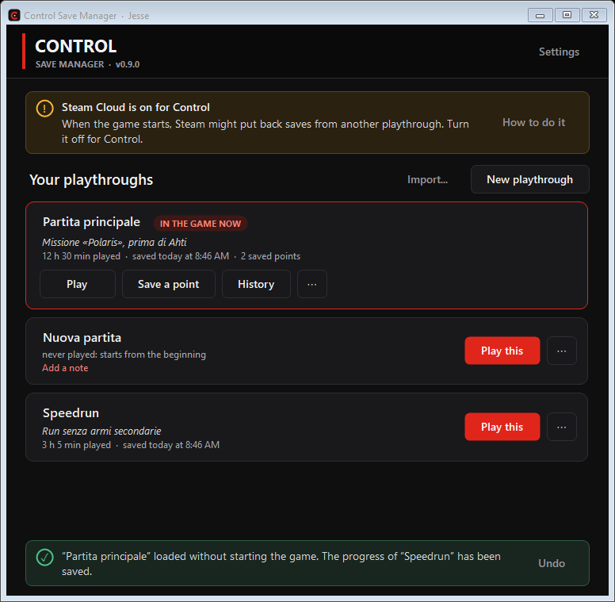
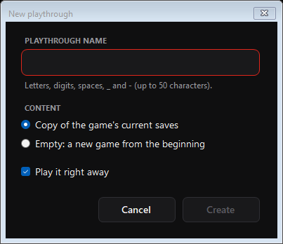
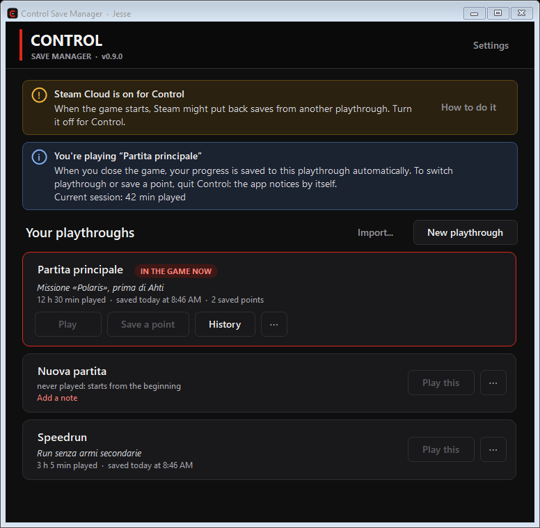
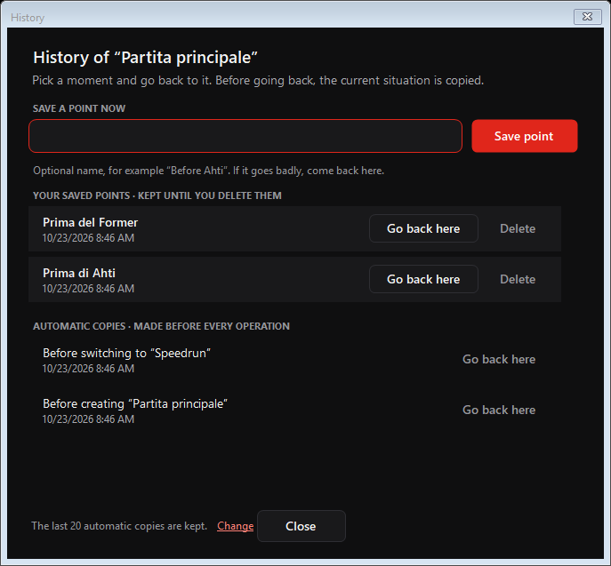
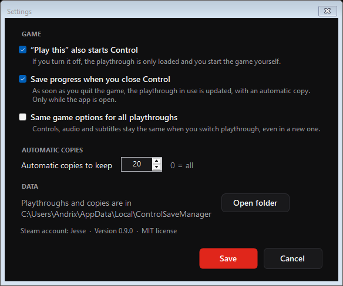

# Control Save Manager

Several playthroughs of **Control** (Steam) on the same account: pick the one
you want to play and the app loads its saves and starts the game. With saved
points for the hard parts and an automatic copy before every operation.

The app is in English or Italian, following the Windows language.

## Installation

1. Download `ControlSaveManager-<version>-win-x64.zip` from the
   [releases page](https://github.com/Andrix64/Control-Savegame-Switcher/releases)
   and extract `ControlSaveManager.exe` wherever you like.
2. Run it. Nothing to install: the program already contains everything it
   needs (that's why it's about 50 MB).

Requirements: Windows 10 or 11, 64-bit, and Control on Steam started at least
once.

> **Digital signature.** Releases published on GitHub will be signed by
> SignPath Foundation (see [CODE_SIGNING.md](CODE_SIGNING.md)) once signing is
> active: each release page says whether the exe is signed. An unsigned exe
> may show "Windows protected your PC" (choose *More info → Run anyway*), and
> Smart App Control, if it's on, may block it. Even when signed, SmartScreen
> may warn for a while until the program becomes known.

On first start the app asks what to call the playthrough already in the game
and saves it as your first playthrough.

### Before you start: turn off Steam Cloud for Control

With Steam Cloud on, Steam may put back saves from another playthrough when
the game starts. Turn it off for Control: in Steam, **Library → right-click
Control → Properties → General**, and switch off *Keep games saves in the
Steam Cloud*. While it's on, the app shows a yellow bar at the top.

## How to use it

### Playthroughs

Each playthrough has its own saves. The one with the red border and
*IN THE GAME NOW* is the one loaded in the game.

- **Play this**: saves the progress of the current playthrough, loads the
  chosen one and starts Control through Steam. No questions asked: a copy is
  made before every switch.
- **Play**, on the playthrough already in the game: only starts Control.
- **⋯** on every playthrough: *Load without starting*, *Rename*, *Edit note*,
  *Export to a file...* and *Delete playthrough...*. If you load without
  starting, an **Undo** button appears at the bottom to go straight back to
  the previous playthrough.
- **New playthrough**: with the game's current saves, or empty to start again
  from the beginning.

  

- **Import...**: adds a playthrough exported on another PC.

Each card shows the note, the play time, when it was last saved and the saved
points.

### While you play

While Control is running the app doesn't touch the saves and says so at the
top. When you close the game, your progress is saved automatically to the
playthrough you were playing and the play time is updated (the app needs to
be open).

### History and saved points

**Save a point** (on the playthrough in the game) saves the current saves
under a name, for example before a boss: if it goes badly, you go back there.
**History** shows your saved points and the automatic copies made before
every operation; each row has **Go back here**. Before going back, the
current situation is copied, so you can always change your mind.

### Settings

- *“Play this” also starts Control*: if you turn it off, the playthrough is
  only loaded.
- *Save progress when you close Control*.
- *Same game options for all playthroughs*: controls, audio and subtitles stay
  the same when you switch playthrough.
- How many automatic copies to keep (20 by default, 0 = all).

## Where the files are

Playthroughs, saved points, automatic copies and the operation log
(`log.txt`) are in `%LOCALAPPDATA%\ControlSaveManager` (usually
`C:\Users\<name>\AppData\Local\ControlSaveManager`). OneDrive doesn't sync
that folder, so saves aren't locked, half-downloaded or duplicated as
"conflict copies". Settings has a button to open it; otherwise press Win+R and
type `%LOCALAPPDATA%\ControlSaveManager`.

If more than one Steam account on the PC has Control, the app asks which one
to use at startup; each account has its own playthroughs.

If you used a test version that saved to `Documents\ControlSaves`, the data is
moved to the new folder automatically on first start, and the app tells you.

To uninstall, just delete the exe. If you want, also delete
`%LOCALAPPDATA%\ControlSaveManager` (but that's where your playthroughs are).

## FAQ

**I loaded the wrong playthrough.** If the game didn't start, press **Undo**
in the notice at the bottom; otherwise play the previous one: its progress was
saved before the switch.

**I lost some progress.** Open **History**: there's a copy before every
operation, with date and description.

**I deleted a playthrough by mistake.** *Deleted playthroughs* appears at the
bottom of the main window: recover it from there, until the cleanup of
automatic copies removes it.

**Saves get mixed up between playthroughs.** It's almost always Steam Cloud:
make sure it's off (see above).

## License

[MIT](LICENSE). What's new in each version: [CHANGELOG](CHANGELOG.md). For
developers: [docs/DEVELOPMENT.md](docs/DEVELOPMENT.md).

*Control is a trademark of Remedy Entertainment. This program is not
affiliated with or endorsed by Remedy or Valve.*
